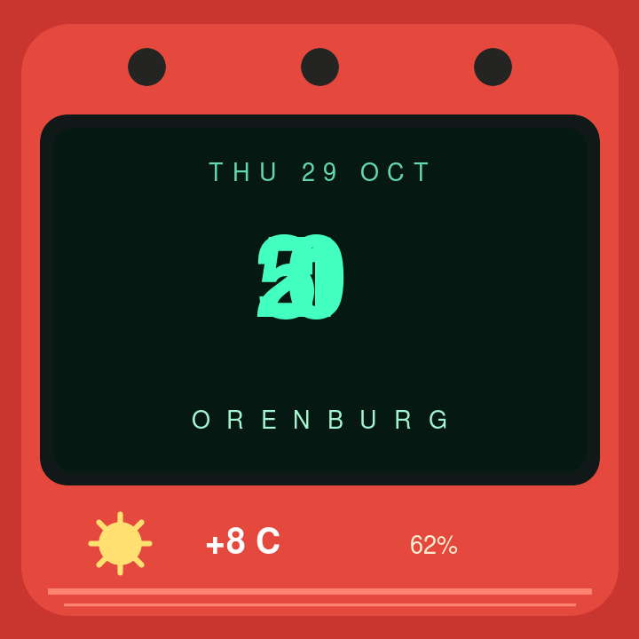

# Watchface

Notes and artifacts for a custom face for the Smart Weather Clock / SD Pro,
running SmartClock-OSS.

## Current face

`assets/retro-orenburg-face.json` is the custom face saved on the clock as
`retro_orenburg`. The current on-device version has a red outer frame, a dark
display, large mint-green time, and weather details. A black-and-brighter-green
redesign with true seven-segment digits is the next design goal; see
[`docs/segmented-renderer-plan.md`](docs/segmented-renderer-plan.md).

The current face uses the firmware's large built-in digit font. SmartClock-OSS
does not include a seven-segment font, so the digits are not true seven-segment
glyphs.

## Device and firmware

- Device family: Smart Weather Clock / SD Pro, identified by its settings page.
- Firmware: SmartClock-OSS 1.3.2, verified from the device status endpoint.
- Time zone: `YEKT-5` (Orenburg, UTC+05:00, no daylight-saving transition).
- City: Orenburg.
- Device and firmware interfaces are served over local HTTP.
- The stock SD Pro firmware is a separate project; its repository provides
  prebuilt ESP8266 images but no source code.

The compatible replacement firmware is maintained at
[michaeldale/smartclock-oss](https://github.com/michaeldale/smartclock-oss).
Its 1.3.2 release is available at
[the upstream release page](https://github.com/michaeldale/smartclock-oss/releases/tag/v1.3.2).
The official image is named `SDPro_SmartClockOSS_v1.3.2.bin`; verify its
SHA-256 against the upstream release's `SHA256SUMS.txt` before installing.

The replacement firmware does not play animated GIFs. Returning to the stock
firmware over Wi-Fi is not supported; recovery to stock requires a USB-UART
adapter and access to the board's serial pads.

## Integrations and a segmented-display service

The firmware supports custom JSON faces, Home Assistant dashboard uploads, and
MQTT. These integrations are off by default. Custom faces accept dynamic
placeholders such as `{time}`, `{temp}`, `{hum}`, and `{city}`. Firmware font
sizes 6 and 8 are large digits, but are not seven-segment fonts.

For a true segmented display, a local service can:

1. Render time, date, and optional weather into a 240x240 JPEG.
2. Keep the same photo filename and replace its contents on each update.
3. Use the firmware's `/photo/upload` API to upload the image.

The Home Assistant-compatible API is unauthenticated when that integration is
enabled and can be reached by devices on the LAN. Restrict access to a trusted
network or allow only the rendering server. Each upload writes flash storage;
the upstream documentation recommends intervals of at least 30 seconds. Photo
uploads are limited to 200 KB.

No rendering service is included in this repository yet.

## Layout

- `assets/retro-orenburg-face.json`: face JSON uploaded to the clock.
- `assets/retro-orenburg-preview.png`: preview image.
- `assets/retro-orenburg-preview.svg`: editable vector preview.
- `docs/research.md`: research notes and source links.
- `docs/segmented-renderer-plan.md`: findings for a future Orange Pi renderer.
